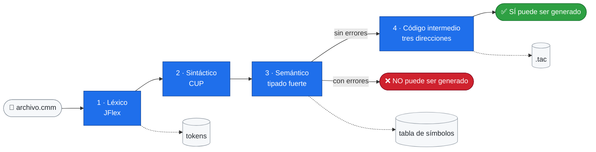

<div align="center">

#  Compilador `.cmm`
### Análisis Semántico y Generación de Código Intermedio

**Instituto Tecnológico de Costa Rica** · Compiladores e Intérpretes (IC-5701) · II Semestre 2026


| Estudiante | Carné |
| :-- | :--: |
| Heldyis Agüero Espinoza | 2023296812 |
| Alice Arias Salazar | 2023104639 |

**Profesor:** Allan Rodriguez Davila · **Proyecto #2** · **Entrega:** 9 de noviembre de 2026

</div>

---

##  ¿Qué hace?

Recibe un programa `.cmm`, lo analiza en **cuatro fases** y dice si el archivo **SÍ** o **NO** puede ser generado por la gramática. Los errores no detienen el análisis: se reportan todos, con su línea y columna.



---

##  Estado

- [x] Análisis léxico y sintáctico del Proyecto #1, corregidos
- [x] Análisis semántico con **tipado explícito y fuerte** (52 reglas)
- [x] Tabla de símbolos con **ámbitos anidados**, en consola y en archivo
- [x] Recuperación en **modo pánico**, **a nivel de frase**, **producción de errores** y **corrección global**
- [x] Código intermedio completo: operaciones, asignaciones, `read`/`write`, `++`/`--`, `if`/`elif`/`else`, `while`, `for`, `break`, funciones y arreglos

---

##  Compilar y ejecutar

> [!IMPORTANT]
> Se necesita **Java JDK 21** (mínimo 11). JFlex y Java CUP ya vienen en `Programa/librerias`.

```powershell
cd .\Programa
.\build.bat      # genera el parser y el lexer, y compila todo
.\run.bat        # muestra las pruebas y pide el nombre del archivo
```

O directamente, sin `run.bat`:

```powershell
java -cp "bin;librerias\java-cup-11b.jar" Main pruebas\correctas\pruebasX.cmm
```

> [!TIP]
> Usen una terminal **ancha** (unos 170 caracteres) para ver completas las tablas de errores y de símbolos.

> [!NOTE]
> Cada vez que cambie `Parser.cup`, `Lexer.flex` o un `.java`, hay que volver a ejecutar `build.bat`. Si se agrega un `.java` nuevo en `src/`, también se agrega a la lista del `javac` en `build.bat`.

---

##  Estructura

```text
Programa/
├── build.bat · run.bat
├── gramatica/      Lexer.flex · Parser.cup
├── src/            Main · Atrib · Generador · TablaSimbolos · Simbolo
│                   Ambito · ReporteTablaSimbolos · CuadroTexto
├── librerias/      java-cup-11b.jar · jflex-full-1.9.1.jar
├── pruebas/        correctas/ · con_errores/
├── salida/         tokens/ · tabla_simbolos/ · codigo_intermedio/
└── bin/            lo genera build.bat
```

| Archivo | Responsabilidad |
| :-- | :-- |
| `Parser.cup` | Gramática, **reglas semánticas** y llamadas al generador (decide **cuándo**) |
| `Generador.java` | Formato del código intermedio, temporales y etiquetas (decide **cómo**) |
| `TablaSimbolos.java` y compañía | **Guarda y busca** nombres por ámbito; no decide qué es un error |
| `Main.java` | Coordina las fases, muestra los resultados y hace la corrección global |

---

##  El lenguaje

| Símbolo | Significado | | Símbolo | Significado |
| :--: | :-- | :-: | :--: | :-- |
| `¿:` `:?` | Bloque | | `»` | Fin de sentencia |
| `є:` `:э` | Paréntesis | | `Ͱ` | Asignación |
| `ʃ:` `:ʅ` | Corchetes | | `λ` `θ` `Σ` | Y, O, negación |
| `\|` | Comentario de una línea | | `¡ … !` | Comentario multilínea |

```text
int doble є: int n :э ¿:
    return n + n»
:?

void principal є: :э ¿:
    val int i Ͱ 0»
    while є: ʃ:i:ʅ < ʃ:3:ʅ :э ¿:
        i++
    :?
    write є: doble є: i :э :э»
:?
```

**Precedencia** (de mayor a menor): `pot` → `+ -` → `* / //` → `mod`. Por eso `a + b * 2` es `(a + b) * 2`.

---

##  Análisis semántico

Cada error dice qué **validación** falló. Las 52 reglas, con ejemplos, están en la documentación externa.

| Validación | Qué revisa |
| :-- | :-- |
|  **Nombres** | No repetir en un ámbito, declarar antes de usar, no usar una función como variable ni un arreglo sin índice |
|  **Aritmética** | Solo `int` o `float`, sin mezclarlos; `//` con `int`, `/` con `float`, `pot` con exponente positivo |
|  **Comparación** | Mismo tipo en los dos lados; los `string` no se comparan |
|  **Lógica** | `λ`, `θ` y `Σ` solo con `bool` |
|  **Asignación** | El valor tiene el tipo de la variable |
|  **Arreglos** | Tamaño `int` mayor que 0, valores del tipo correcto, índice dentro del rango |
|  **Funciones / Return** | Cantidad y tipo de argumentos, retorno del tipo correcto, al menos un `return` |
|  **Control** | Condiciones `bool`; `break` solo dentro de un ciclo |
|  **Incremento** ·  **Entrada/Salida** ·  **Programa** | `++`/`--` con números; `read` y `write` con tipos permitidos; existe `principal` |

```diff
  Nº   LÍNEA  COL  VALIDACIÓN   DESCRIPCIÓN
- 01      5   10  Nombres      '_otra_' ya fue declarado en este ámbito (línea 4)
- 02     47   27  Aritmética   no se pueden mezclar 'float' y 'int' con el operador '+' (tipado fuerte)
+ Por validación: Nombres 1   Aritmética 1
```

---

##  Recuperación de errores

| Técnica | Qué hace |
| :-- | :-- |
| 🟥 **Modo pánico** *(obligatoria)* | Descarta tokens hasta un punto seguro, como un `»`, y sigue |
| 🟧 **Nivel de frase** | **Inserta** el `»`, `:э` o `:?` que falta y avisa exactamente qué faltaba |
| 🟨 **Producción de errores** | Reconoce errores comunes (variable o parámetro sin tipo, arreglo de `bool`, `read` sin paréntesis) con un mensaje exacto |
| 🟩 **Corrección global** | Busca el **menor número de cambios** de un token que dejan el archivo sin errores y lo muestra como sugerencia |

---

## ⚙️ Código intermedio

Código de **tres direcciones**, guardado en `salida/codigo_intermedio/<nombre>.tac`.

> [!WARNING]
> Si el archivo tiene **cualquier** error, no se genera código intermedio.

<table>
<tr><th>Programa (<code>prueba_tac.cmm</code>)</th><th>Código intermedio</th></tr>
<tr><td>

```text
void principal є: :э ¿:
    val int a Ͱ 1»
    val int b Ͱ 2»
    val int c Ͱ 0»
    c Ͱ a + b * 2»
    c Ͱ a mod b»
:?
```

</td><td>

```text
void$principal:
declaracionPrevia# int a
int1 = 1
a = int1
...
int4 = a
int5 = b
int6 = int4 + int5
int7 = 2
int8 = int6 * int7
c = int8
...
return
void$principal$final
```

</td></tr>
</table>

| Elemento | Formato | Ejemplo |
| :-- | :-- | :-- |
| Temporales | tipo + número | `int1`, `float2`, `bool3` |
| Funciones | `tipo$nombre:` … `tipo$nombre$final` | `int$suma:` |
| Estructuras | `función$estructura$N$parte` | `principal$while$6$condicion` |
| Declaraciones | `declaracion#` / `declaracionPrevia#` / `param_` | `declaracion# int x` |
| Llamadas | `param x` + `call etiqueta, n` | `int3 = call int$suma, 2` |
| Saltos | `goto` e `if … goto` | `if bool9 goto principal$if$3$bloque1` |

> [!NOTE]
> Las etiquetas usan **`$`** porque ningún identificador puede tenerlo: así una etiqueta nunca se confunde con una variable como `_funcionInt_`.

---

##  Pruebas

| Archivo | Léxicos | Sintácticos | Semánticos | Qué prueba |
| :-- | :-: | :-: | :-: | :-- |
| ✅ `correctas/pruebasX.cmm` | 0 | 0 | 0 | Programa grande con todo el lenguaje (318 instrucciones) |
| ✅ `correctas/prueba_generador.cmm` | 0 | 0 | 0 | Código intermedio completo |
| ✅ `correctas/prueba_tac.cmm` | 0 | 0 | 0 | Código intermedio corto |
| ❌ `con_errores/ejemplo1.cmm` | 0 | 0 | **35** | Ejemplo del profesor |
| ❌ `con_errores/ejemplo2.cmm` | 0 | 0 | **24** | Ejemplo del profesor |
| ❌ `con_errores/prueba_recuperacion.cmm` | **1** | **11** | **2** | Frase, producción de errores y modo pánico |
| ❌ `con_errores/prueba_correccion_global.cmm` | 0 | **3** | 0 | Corrección global con 4 ediciones |
| ❌ `con_errores/prueba_sin_principal.cmm` | 0 | 0 | **1** | Falta la función `principal` |

> [!TIP]
> Después de cualquier cambio, ejecuten estas pruebas y comparen con la tabla. CUP debe decir **`0 conflicts detected`**.

---

##  Archivos que genera

| Archivo | Carpeta | Contenido |
| :-- | :-- | :-- |
| `<nombre>_tokens.txt` | `salida/tokens/` | Tokens con línea, columna y lexema |
| `<nombre>_tabla_simbolos.txt` | `salida/tabla_simbolos/` | Árbol de ámbitos y tabla (igual que en consola) |
| `<nombre>.tac` | `salida/codigo_intermedio/` | Código intermedio (solo sin errores) |

---

##  Limitaciones

- El código intermedio **no se optimiza**.
- La recuperación a nivel de frase no cubre paréntesis dentro de expresiones, índices ni bloques anidados (CUP daría conflictos); ahí actúa el modo pánico.
- La corrección global es una **sugerencia**: no modifica el archivo ni inventa nombres o números.

---

##  Documentación

-  **Externa:** `Documentacion/Documentacion_Proyecto2.pdf` (manual, pruebas, diseño, diagramas y las 52 reglas semánticas)
- 🗺️ **Diagramas:** `Documentacion/Diagramas/` (PNG, SVG y fuentes PlantUML)
- 💬 **Interna:** cada método tiene comentario de *descripción, entrada, salida y restricciones*
- 🕓 **Bitácora:** [historial de commits](https://github.com/Alice-Arias/PY2-Analisis-Semantico-y-Generacion-Codigo-Intermedio-Compiladores/commits/main/)
